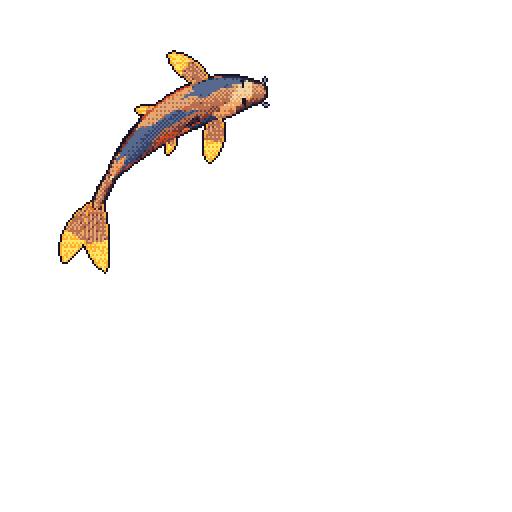

# Yu Xuan Low

Computer Science (Data Science & AI) at University College Dublin 
Backend developer · ML engineer · IOAI 2026 bronze medalist

[Website](https://yxlow07.github.io) · [Blog](https://yxlow07.github.io/blog) · [CV](https://yxlow07.github.io/CV_Low_Yu_Xuan.pdf) · [LinkedIn](https://www.linkedin.com/in/low-yu-xuan/) · [Email](mailto:yuxuanlow013@gmail.com)

 

My koi grows with my commits. Drawn nightly by <a href="https://github.com/yalongwastaken/git-koi">git-koi</a>.

 

### About

I build end-to-end ML systems and the backend services they run on, mostly in computer vision, NLP and predictive modelling. I also compete in AI and programming olympiads, and these days I help train the next Malaysian team for them.

### Now

- Studying CS with Data Science & AI at **University College Dublin**
- Training students for international AI olympiads at the **Malaysian AI Olympiad Fellowship**
- Technical Director at **AMISO**, leading a team of five developers
- Vice President of Activities, **21st INTIMA**
- Looking for software engineering and AI/ML research opportunities

### Selected work

| Project | What it is | Built with |
| :-- | :-- | :-- |
| [**Diabetic Retinopathy Screening**](https://github.com/yxlow07/NAIC2026) | Ensemble retinal-image classifier, 91% accuracy on small, unbalanced data. Champion, NAIC 2026 | PyTorch · OpenCV · scikit-learn |
| [**Byte of Kuih**](https://github.com/yxlow07/naic-model-2025) | EfficientNetV2 classifier for 8 Malaysian kuih, trained on a 16k-image dataset I curated. 1st Runner Up, NAIC 2025 | PyTorch · Hugging Face |
| [**JotMe**](https://github.com/yxlow07/jotme) | Journaling app with emotion detection, keyword extraction and graph-based sentiment analysis | Transformers · KeyBERT · NetworkX |
| [**GUIDE-SHARK**](https://github.com/yxlow07/guide-shark-frontend) | Health-diagnostics app with AI symptom analysis | Flutter · Django REST |
| **Embrace Study** (NDA) | Secure participant tracking for a 200+ person postpartum study | Next.js · Supabase |

### Highlights

- **IOAI 2026**: Bronze medal
- **APOAI 2026**: Honorable mention
- **NAIC**: Champion 2026, 1st Runner Up 2025
- **Northern Eurasia OAI 2026**: Rank 4 / 188 (Day 1)
- **MAIO**: Rank 1 in 2026 qualifiers, Gold 2025
- **HackUCD 2026**: 3rd place
- **USACO** Gold · **Codeforces** Specialist (1429) · **MCO 2025** Silver · **CALICO 2024** Silver

### Toolkit

**Languages** 

**Machine learning** 

**Backend & apps** 

### GitHub stats

  
  

  

### Writing

- [HackUCD: our first hackathon in Ireland](https://yxlow07.github.io/blog/hackucd-our-first-hackathon-at-ireland/)
- [Byte of Kuih: NAIC 2025](https://yxlow07.github.io/blog/naic/)
- [JotMe at LingHacks VI](https://yxlow07.github.io/blog/linghacks-vi/)
- [More on the blog →](https://yxlow07.github.io/blog)

 

Open to internships, research collaborations and hackathon teams. Say hi at <a href="mailto:yuxuanlow013@gmail.com">yuxuanlow013@gmail.com</a>.

